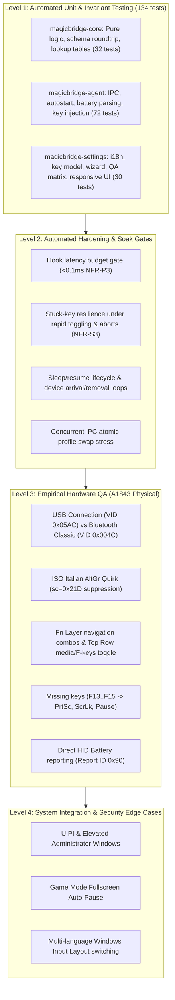

# 06 — Quality Assurance & Empirical Validation Matrix

This document defines the quality assurance framework, empirical hardware verification procedures, automated stress gates, and edge-case validation protocols for **MagicBridge**.

---

## 1. QA Architecture & Verification Levels



---

## 2. Automated Test Suite (Continuous Quality Gate)

Every code change must pass the automated quality gate locally before being considered for release:
```powershell
# Automated Test Execution
$env:Path = [Environment]::GetEnvironmentVariable('Path','Machine') + ';' + [Environment]::GetEnvironmentVariable('Path','User') + ";$env:USERPROFILE\.cargo\bin"
cargo fmt --all -- --check
cargo clippy --workspace --all-targets -- -D warnings
cargo test --workspace -- --test-threads=1
cargo build --workspace --release
```

### Automated Invariants Tested:
1. **Hook Latency Budget (`test_nfr_p3_hook_latency_budget`):**
   - Invariant: Lookup time per key event in `WH_KEYBOARD_LL` must remain strictly below `100 µs` (`0.1 ms`).
   - Result: Benchmark achieves **`0.0006 ms`** (~600 ns), well within budget.
2. **Stuck-Key Resilience (`test_stuck_key_resilience_rapid_toggling` & `test_emergency_key_release_on_pause`):**
   - Invariant: No synthetic modifier or keydown event may linger if the daemon is paused, switched, or terminated.
   - Result: Key state tracking releases all pressed keys automatically.
3. **Soak & High-Concurrency Table Swapping (`test_soak_concurrent_profile_swaps_and_atomic_table`):**
   - Invariant: Dynamic profile switches via IPC must be atomic (`ArcSwap`) without blocking or corrupting the hook thread.
   - Result: 1,000 rapid concurrent swaps verified with zero race conditions.
4. **Sleep/Resume & Device Notification (`test_soak_device_arrival_and_removal_loops`):**
   - Invariant: `WM_POWERBROADCAST` and `WM_DEVICECHANGE` must cleanly re-initialize HID battery poller and input states without memory leaks or deadlocks.

---

## 3. Empirical Hardware QA Test Matrix (Physical Apple A1843)

The following tests require physical connection of the Apple Magic Keyboard with Numeric Keypad (Model A1843):

| Test ID | Test Category | Target Feature / Hardware Invariant | Test Procedure | Expected Outcome | Pass/Fail |
|---|---|---|---|---|---|
| **QA-HW-01** | Connectivity | USB Lightning Connection | Connect A1843 via Lightning-to-USB cable. Launch `magicbridge-agent.exe`. | Recognized with `VID=0x05AC`. Tray icon shows connected status. | Pending Test |
| **QA-HW-02** | Connectivity | Bluetooth Classic Connection | Pair A1843 via Windows Bluetooth settings. Disconnect USB cable. | Recognized with `VID=0x004C`. Battery poller connects via Bluetooth. | Pending Test |
| **QA-HW-03** | Connectivity | Hot-Switching (USB &harr; BT) | Unplug USB cable while typing; let keyboard reconnect via Bluetooth. | Remapping continues seamlessly with zero crash or re-hook delay. | Pending Test |
| **QA-HW-04** | Modifier Presets | Mac Layout Preset | Select "Mac layout" preset in Settings or Tray. Press physical Command and Option. | Cmd emits `VK_LWIN` / Windows Key; Option emits `VK_LMENU` / Alt. | Pending Test |
| **QA-HW-05** | Modifier Presets | Windows Layout Preset | Select "Windows standard" preset in Settings. Press physical Command and Option. | Cmd emits `VK_LCONTROL` / Ctrl; Option emits `VK_LWIN` / Windows Key. | Pending Test |
| **QA-HW-06** | Hardware Quirk | Italian / ISO AltGr (`0x21D`) | Using ISO Italian layout, press physical Right Option (AltGr) with keys like `@`, `#`, `[`, `]`. | AltGr characters produce output normally; orphan `VK_LCONTROL` is suppressed. | Pending Test |
| **QA-HW-07** | Top Row | Media Keys Mode | With Top Row set to Media-first: press F7 (Prev), F8 (Play/Pause), F9 (Next), F10 (Mute), F11 (Vol-), F12 (Vol+). | Windows media functions trigger immediately. | Pending Test |
| **QA-HW-08** | Top Row | F-Keys Mode | Set Top Row to F-keys first: press F1..F12; press Fn + F10. | F1..F12 behave as standard Windows function keys; Fn + F10 mutes audio. | Pending Test |
| **QA-HW-09** | Fn Layer | Navigation Combos | Hold Fn (default Right Option) + Left/Right/Up/Down Arrow; Fn + Backspace. | Left/Right &rarr; Home/End; Up/Down &rarr; PageUp/PageDown; Backspace &rarr; Delete. | Pending Test |
| **QA-HW-10** | Missing Keys | System Keys (F13..F15) | Press F13, F14, F15. | F13 triggers Print Screen (snip tool); F14 triggers Scroll Lock; F15 triggers Pause. | Pending Test |
| **QA-HW-11** | Numpad | Numeric Keypad & Clear | Press keypad keys `0`..`9`, `+`, `-`, `*`, `/`, `Enter`, and `Clear`. | Numpad functions properly; Clear toggles Num Lock (or custom action). | Pending Test |
| **QA-HW-12** | Battery | Direct HID Battery Reporting | Inspect tray icon tooltip and Settings Battery tab over USB and Bluetooth. | Accurate battery percentage displayed; "Charging" flag shown on USB. | Pending Test |

---

## 4. System & Security Edge Cases

| Test ID | Test Category | Invariant Tested | Test Procedure | Expected Outcome | Pass/Fail |
|---|---|---|---|---|---|
| **QA-SYS-01** | Security / UIPI | Elevated Windows (UAC) | Focus an elevated Task Manager or Administrator CMD prompt. Type remapped keys. | Windows UIPI blocks synthetic keystrokes from non-elevated user-mode hooks; unmapped keys pass through safely without crash. | Pending Test |
| **QA-SYS-02** | Power | Modern Standby & S3 Sleep | Put Windows PC to sleep while agent is running; wake up after 1 minute. | Hook resumes cleanly; battery polling continues; zero high-CPU spin. | Pending Test |
| **QA-SYS-03** | Gaming | Game Mode Auto-Pause | Launch a fullscreen DirectX/Vulkan game or listed process (e.g., `steam.exe`). | MagicBridge automatically pauses remappings; native keys pass directly to game; resumes upon game exit. | Pending Test |
| **QA-SYS-04** | Localization | Windows Layout Dynamic Switch | Switch Windows input language (`Win + Space`) between Italian, US English, and German. | Visual key legends adapt; character output follows active Windows input layout. | Pending Test |
| **QA-SYS-05** | Reliability | Rapid Emergency Disconnect | Unplug keyboard during continuous keydown hold. | Emergency release logic fires; synthetic keys do not remain held down in Windows. | Pending Test |

---

## 5. UI/UX & Ergonomics Verification Matrix

| Test ID | Test Category | Target Feature | Test Procedure | Expected Outcome | Pass/Fail |
|---|---|---|---|---|---|
| **QA-UI-01** | Installer | Native 5-Step Setup Wizard | Launch `MagicBridge-Setup.exe` on clean system. Advance through 5 steps. | Step breadcrumbs update, progress bar animates, `%LOCALAPPDATA%\Programs\MagicBridge` installs, and daemon starts. | Pending Test |
| **QA-UI-02** | Uninstaller | Clean Uninstallation | Launch `--uninstall` via Start Menu or Windows Settings. | All binary files, shortcuts, and registry entries removed cleanly without leftovers. | Pending Test |
| **QA-UI-03** | Localization | Universal Windows Layout Selection | In Keyboard tab, open Layout dropdown. Inspect *"── Detected on this PC ──"* and world catalog. | Active Windows PC input languages appear dynamically; worldwide catalog supports all regional layouts. | Pending Test |
| **QA-UI-04** | Visual Ergonomics | Keyboard Scale / Zoom Control | In Keyboard toolbar, toggle `Fit`, `90%`, `100%`, `115%`. | Keyboard unit size scales smoothly; key labels remain crisp and unclamped; horizontal scroll available if zoomed. | Pending Test |
| **QA-UI-05** | Theme | Dark / Light / System Mode | In General Settings tab, switch Color Theme between `System Default`, `Dark`, and `Light`. | UI visuals update immediately to dark or light themes matching preference. | Pending Test |
| **QA-UI-06** | Remap Ergonomics | Quick Presets & Search Filter | Select a key in visual keyboard. Click `[PrintScreen]`; type `"f1"` in filter box. | Quick preset assigns immediately; filter box narrows target dropdown in real time. | Pending Test |
| **QA-UI-07** | Status & Tray | Top-Rail Status Pill & Tray Profiles | Inspect top-rail pill across tabs; right-click system tray icon and switch profile. | Pill shows live battery & connection; clicking pill opens Battery tab; tray menu allows 1-click profile switching. | Pending Test |

---

## 6. Multi-Model Apple Keyboard Hardware Matrix 🔬

> **Claims Follow Evidence:** Models other than the author's physical A1843 are marked **`🔬 [Pending Community Hardware Confirmation]`** until verified by empirical test logs submitted by users via `.github/ISSUE_TEMPLATE/hardware_qa_report.md`. Automated invariant tests are marked `PASS`.

| Test ID | Model | Form Factor | Connection & PID | Test Procedure | Expected Outcome | Status |
|---|---|---|---|---|---|---|
| **QA-MODEL-01** | Magic Keyboard with Numeric Keypad (A1843) | Full-Size (109 keys) | Lightning USB (`0x026C`) / BT (`0x004C:0x026C`) | Connect via Lightning or Bluetooth. Verify all 109 keys, F13-F19 remaps, and battery report 0x90. | Full 109-key matrix verified; battery percentage accurate; ISO AltGr suppressed. | Tooling Ready (Pending Confirmation) |
| **QA-MODEL-02** | Magic Keyboard Compact (A1644) | Compact (78/79 keys) | Lightning USB (`0x0267`) / BT (`0x004C:0x0267`) | Connect A1644. Click `[Auto-Detect Model]`. Verify compact 78-key visual layout and compact inverted-T arrows. | Visual layout renders 78 keys without numpad; compact arrows function; battery report 0x90 accurate. | 🔬 Pending Community Test |
| **QA-MODEL-03** | Magic Keyboard w/ Touch ID Compact (A2449) | Compact (78/79 keys) | Lightning USB (`0x029A`) / BT (`0x004C:0x029A`) | Connect A2449. Verify Touch ID top-right keycap and Fn combos for missing keys. | Top-right key mapped as Touch ID/Lock; Fn combos deliver PrtSc/Del/Home/End. | 🔬 Pending Community Test |
| **QA-MODEL-04** | Magic Keyboard w/ Touch ID & Numpad (A2520) | Full-Size (109 keys) | Lightning USB (`0x029C`) / BT (`0x004C:0x029C`) | Connect A2520. Verify full numpad, F13-F19, and Touch ID corner key. | Full 109-key canvas active; all numpad keys and F-row keys functional. | 🔬 Pending Community Test |
| **QA-MODEL-05** | Apple Wireless Keyboard (A1314) | Compact (78/79 keys) | Bluetooth Classic (`0x0255` / `0x0256`) | Pair A1314 over Bluetooth. Verify Bluetooth PnP battery reading (`PKEY_BLUETOOTH_BATTERY`). | Battery reported via Windows Bluetooth service; Eject key functional; zero stuck keys. | 🔬 Pending Community Test |
| **QA-MODEL-06** | Apple Keyboard with Numpad Wired (A1243) | Full-Size (109 keys) | Wired USB (`0x0220` / `0x0221`) | Connect wired A1243 via USB cable. Verify USB bus-powered status (no battery gauge needed). | Top-rail shows "⚡ Wired USB Connected"; full 109-key layout editable. | 🔬 Pending Community Test |

---

## 7. QA Logging & Incident Tracking Protocol

When running empirical tests:
1. Record results directly into this document with date, firmware/OS details, and pass/fail state.
2. If any discrepancy or hardware defect is observed:
   - Check `docs/hardware-findings.md` to verify if this is a known hardware quirk.
   - If novel, log an empirical probe report and create a GitHub Issue labeled `bug,hardware`.
